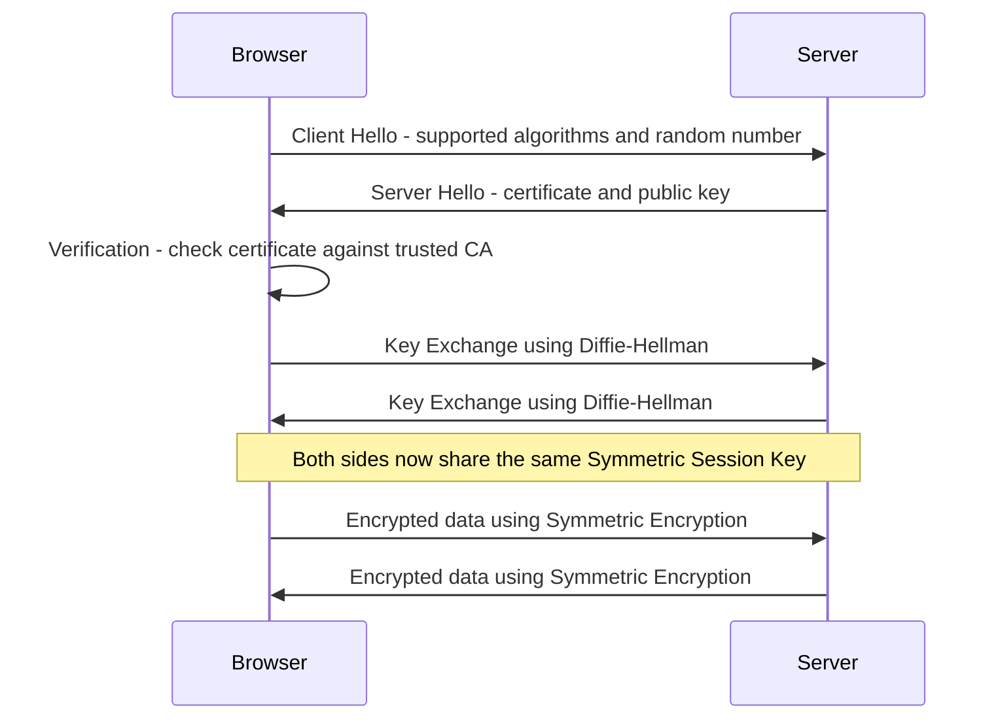

> **Goal of this section:**
> You'll understand how all the topics we've studied from the start (Symmetric, Asymmetric, Hashing, HMAC, Digital Signature, Digital Certificate) actually work together in one real protocol that runs every time you open any site over HTTPS. This is the practical conclusion to the whole series.

## Table of Contents
- [Why Do We Need a Handshake?](#why-do-we-need-a-handshake)
- [The Hybrid Design Principle](#the-hybrid-design-principle)
- [The TLS Handshake — Step by Step](#the-tls-handshake--step-by-step)
- [Mapping Each Step to What You Already Learned](#mapping-each-step-to-what-you-already-learned)
- [Which Security Properties Does the Full Handshake Achieve?](#which-security-properties-does-the-full-handshake-achieve)
- [What Happens After the Handshake](#what-happens-after-the-handshake)
- [What Can Still Go Wrong](#what-can-still-go-wrong)
- [Summary](#summary)
- [SOC Analyst Perspective](#soc-analyst-perspective)

---

## Why Do We Need a Handshake?

Every time you open a site over **HTTPS** and see the padlock in the browser, a process called the **TLS Handshake** happens in the background, before any actual data (such as the page content) is transferred between you and the server.

> [!IMPORTANT]
> The core question the Handshake answers: **how can two parties (the browser and the server) communicate with complete security, even though it's the first time they've "met" on the internet, and there may be an attacker watching everything between them?**

The answer isn't a single technique — it's **all the topics we've studied from the start until now, working together in perfect harmony.**

---

## The Hybrid Design Principle

Before we get into the details, you need to understand the core principle TLS is built on:

| Phase | Task | Type of Encryption Used |
|---|---|---|
| **Startup** | Proving identity + agreeing on a key | Asymmetric (slow but secure) |
| **Transfer** | Transferring the actual page data | Symmetric (fast and efficient) |

> [!IMPORTANT]
> This is the **Hybrid Design** we talked about at the end of the Symmetric Encryption topic. The reason: Asymmetric Encryption is very secure for proving identity and agreeing on a secret, but it's slow and computationally expensive — so it doesn't make sense to use it to transfer a full page with images and videos. The solution: use it only at the critical moment (the start), then switch to Symmetric for speed.

---

## The TLS Handshake — Step by Step

### 1. Client Hello

The browser sends the server:
- The algorithms it supports (Supported Algorithms)
- A random number that will be used later to calculate the Session Key

### 2. Server Hello

The server responds with:
- **Its Digital Certificate** — to prove its identity
- Its **Public Key**

### 3. Verification

The browser verifies the validity of the certificate it received:
- Is it signed by a trusted **Certificate Authority (CA)** that's in the Trust Store?
- Is it still valid (not expired)?
- Does the domain name match the one you're actually browsing?

> [!WARNING]
> If any of these conditions fails, the browser stops the connection immediately and shows you a warning such as "Your connection is not private" — this is exactly the practical application of everything we discussed in the Digital Certificate & CA topic.

### 4. Key Exchange

The browser and the server use **Diffie-Hellman** (or a similar key exchange algorithm) to arrive at a shared **Symmetric Session Key** without actually sending it over the network — even if an attacker is watching everything, they won't be able to calculate the same key.

After this step, both parties have the same Session Key, and from here on they switch to **Symmetric Encryption** for speed.

---

## Mapping Each Step to What You Already Learned

To see clearly how each topic we studied plays its exact role:

| Handshake Step | The Topic We Studied |
|---|---|
| The server presents its certificate | **Digital Certificate & CA** |
| The browser verifies the certificate and its signature | **Digital Signature** (the CA's signature on the certificate) |
| Securely agreeing on the Session Key | **Asymmetric Encryption + Diffie-Hellman (Key Exchange)** |
| Transferring the actual page data quickly | **Symmetric Encryption** |
| Making sure the data wasn't changed during the session | **Hashing / HMAC** |

> [!TIP]
> If you think back over all the sections we've studied, you'll find that each one solved a specific problem that appeared in the one before it — and the TLS Handshake is the place where all these solutions come together in one integrated system that actually runs on every site you visit every day.

---

## Which Security Properties Does the Full Handshake Achieve?

Unlike each topic on its own, which achieved only part of the 5 principles, the TLS Handshake as a whole (as an integrated system) achieves all five together:

| Security Property | Achieved? | Where It Comes From |
|---|---|---|
| **Confidentiality** | ✅ | Symmetric Encryption (after the Key Exchange) |
| **Integrity** | ✅ | Hashing / HMAC throughout the session |
| **Authentication** | ✅ | Digital Certificate + Digital Signature |
| **Non-repudiation** | ✅ (for the server) | The CA's signature on the certificate |
| **Key Exchange** | ✅ | Asymmetric Encryption + Diffie-Hellman |

> [!IMPORTANT]
> This is exactly why TLS is such a strong protocol — no single technique achieves everything on its own, but **the right combination of all the techniques we studied** covers all 5 principles together.

---

## What Happens After the Handshake

As soon as the Handshake is complete:
- All data (HTML, images, videos, API requests) is encrypted with the agreed **Symmetric Session Key**
- Every message gets an **HMAC or a similar mechanism** added to ensure its integrity
- This session stays active until you close the browser or the session expires; then, if you open a new connection, the Handshake starts over from the beginning

---

## What Can Still Go Wrong

Even with an integrated system like this, there are real weak points you need to be aware of as a defender:

| Scenario | The Risk |
|---|---|
| **Ignored Certificate Errors** | If the user clicks "Proceed anyway" on a certificate warning, all the Authentication guarantees collapse |
| **Weak/Deprecated Algorithms** | If the server still supports old algorithms (such as SSL 3.0 or TLS 1.0), the attacker can force the connection down to a weaker level (Downgrade Attack) |
| **Compromised CA** | If the CA itself is breached or issues a wrong certificate, the browser will trust a completely forged certificate |
| **Malicious Root CA on the device** | As we discussed in the certificates topic, this allows a full MITM without any warning |

---

## Summary

- The TLS/HTTPS Handshake is the real practical application of all the Cryptography topics we've studied from start to finish
- It relies on a **Hybrid Design**: Asymmetric at the start for identity and the Key Exchange, then Symmetric to transfer data quickly
- Its steps: **Client Hello → Server Hello (Certificate) → Verification → Key Exchange → Symmetric Communication**
- Each of its steps is directly tied to a topic we studied: Digital Certificate, Digital Signature, Asymmetric Encryption, Diffie-Hellman, Symmetric Encryption, Hashing/HMAC
- The Handshake as a whole achieves **all 5 Security Properties together** — something none of the individual techniques could achieve on its own
- Despite the system's strength, there are still real weak points (Downgrade Attacks, Compromised CA, ignored certificate warnings) that every SOC analyst must be aware of

---

## SOC Analyst Perspective

- In any analysis of network traffic that contains HTTPS, you need to examine the details of the **TLS Handshake** itself, not just the encrypted content after it — the TLS version, the algorithms used, and the certificate details are all valuable information during an incident investigation
- MITRE ATT&CK: technique **T1557 (Adversary-in-the-Middle)** covers attacks that aim to break or bypass the TLS Handshake, and technique **T1600 (Weaken Encryption)** describes attempts to force the connection to use weaker algorithms (Downgrade Attacks)
- Important warning signs in the logs: unexpected **Self-Signed** certificates, connections using the old **TLS 1.0/1.1**, or repeated connection attempts with certificate errors — all of these are indicators worth escalating
- Practical tools: **Wireshark** (to analyze the TLS Handshake in detail), **SSL Labs (ssllabs.com)** to test the strength of any server's TLS configuration, and **OpenSSL** (`openssl s_client -connect domain:443`) for direct manual testing from the terminal
