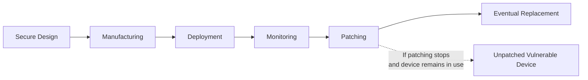

| Topic | Level | Reading Time | Prerequisites |
|---|---|---|---|
| IoT Devices and Their Security Challenges | Beginner | ~15 min | Basic understanding of networking and general security concepts |

> **Goal of this section:**
>  You'll understand what IoT devices are and why they pose a major security challenge, and you'll learn how things like limited resources and the lack of updates make these devices vulnerable to compromise over time.

## Learning Objectives

By the end of this section, you will be able to:

- Define **IoT (Internet of Things)** and identify common examples of IoT devices.
- Explain why the scale of IoT devices creates a large **attack surface**.
- Describe how limited hardware resources affect security implementation in IoT devices.
- Explain how a vulnerability like **Shellshock** can affect Linux-based IoT devices.
- Evaluate why IoT security must be considered across the entire **device lifecycle**, not just at the point of purchase.

## Table of Contents

- [What Is IoT](#what-is-iot)
- [The Scale Problem: IoT and the Attack Surface](#the-scale-problem-iot-and-the-attack-surface)
- [Resource Constraints in IoT Devices](#resource-constraints-in-iot-devices)
- [The Absence of a Universal Security Standard](#the-absence-of-a-universal-security-standard)
- [Linux in IoT Devices and the Shellshock Example](#linux-in-iot-devices-and-the-shellshock-example)
  - [Understanding Shellshock](#understanding-shellshock)
  - [Linux Does Not Equal Vulnerable](#linux-does-not-equal-vulnerable)
- [Why Manufacturers Fall Short on Security](#why-manufacturers-fall-short-on-security)
- [IoT Security Across the Device Lifecycle](#iot-security-across-the-device-lifecycle)
- [Device Lifecycle Diagram](#device-lifecycle-diagram)
- [Career Connection](#career-connection)
- [Key Terms Glossary](#key-terms-glossary)
- [Summary](#summary)

## What Is IoT

**IoT (Internet of Things)** refers to physical devices that connect to networks or the internet to **collect**, **process**, and **exchange** data.

These devices are almost everywhere in our daily lives. Some of the most common examples are:

- **Smart speakers**.
- **Smart TVs**.
- **Security cameras**.
- **Smart watches**.
- **Sensors**.
- **Smart appliances**.
- **Automated garage systems**.

> [!NOTE]
> The core idea of IoT isn't just that the device is "connected to the internet," but that it can collect data from its surrounding environment (such as temperature, motion, or sound) and use it or send it elsewhere for processing.

## The Scale Problem: IoT and the Attack Surface

The number of connected IoT devices around the world is enormous, and this creates a large **attack surface** for attackers. Every device connected to the network represents a **potential entry point**, and the more devices there are, the more opportunities an attacker has to find a weak device they can exploit.

> [!IMPORTANT]
> The sheer volume of IoT devices isn't just a statistic; it's a fundamental security factor, because it means that even a small percentage of weak devices can represent a huge absolute number of compromisable targets.

## Resource Constraints in IoT Devices

Unlike traditional computers, many IoT devices come with very limited resources, such as:

- A relatively weak **CPU**.
- Limited **memory**.
- Small **storage**.
- Limited **power**, especially in battery-powered devices.

These constraints make implementing advanced security mechanisms (such as strong encryption or intrusion detection systems) technically harder, because the device itself may not be able to handle the computational load required to run that protection efficiently.

> [!WARNING]
> Limited resources aren't an excuse to ignore security, but they are a real engineering challenge that requires smart security design from the start, not just bolting on a traditional layer of protection at random.

## The Absence of a Universal Security Standard

There's no single **universal security standard** that guarantees the same level of protection for all IoT devices. The level of security depends heavily on:

- The **manufacturer**.
- The **device design** itself.
- The **operating system** used.
- The **update policy** the company commits to.

Some devices receive security updates regularly, while others receive updates only for a short period, or are **discontinued** and left without any patches.

> [!IMPORTANT]
> A device that was secure at the time of purchase can **become vulnerable years later**, when new vulnerabilities are discovered and the manufacturer no longer provides security updates for it. Security isn't a fixed state; it's an ongoing process throughout the device's life.

## Linux in IoT Devices and the Shellshock Example

### Understanding Shellshock

Many IoT devices use operating systems based on **Linux**, which means any vulnerability affecting Linux components could affect a huge number of different devices at the same time.

A real-world example of this is the **Shellshock** vulnerability, a critical vulnerability discovered in the **Bash shell** that affected a large number of Unix and Linux systems. IoT devices that used vulnerable versions of Bash were also exposed to exploitation, if that vulnerable component was present and **reachable** by the attacker.

### Linux Does Not Equal Vulnerable

> [!NOTE]
> The important lesson here is that using Linux by itself **doesn't automatically make the device vulnerable**. For the device to actually be exploitable, two conditions must be met together: the device must contain the affected version of the vulnerable software, and there must be a real **attack path** that allows that vulnerability to be exploited.

This point is very important for sound security thinking: the presence of a component known to be vulnerable isn't enough on its own to consider the system compromised; we need to understand whether it can actually be reached and exploited.

## Why Manufacturers Fall Short on Security

Devices that are manufactured and deployed without any later updates can remain vulnerable to **publicly known security issues** for many years.

The reason often comes down to the manufacturers' priorities, which usually focus on:

- **Low cost**.
- **Small hardware**.
- **Fast development**.
- **Time-to-market**.

These priorities can lead to weaker security capabilities or limited long-term support. Some of the most common problems that result:

| Problem | Description |
|---|---|
| Outdated encryption | Using weak or obsolete encryption algorithms |
| Weak authentication | Authentication mechanisms that are insufficient to protect access to the device |
| Insecure default passwords | Using well-known, publicly available default passwords |
| Outdated communication protocols | Old versions of protocols such as Bluetooth with known vulnerabilities |

> [!WARNING]
> If the manufacturer doesn't provide a **practical update mechanism**, the user may have no real way to fix vulnerabilities discovered after purchase, even if they want to update the device themselves.

## IoT Security Across the Device Lifecycle

Based on all the previous points, IoT device security must be considered across the entire **device lifecycle**, not just at the moment of purchase or first use. This includes:

- **Secure design** from the manufacturing stage.
- The **manufacturing** process itself.
- **Deployment** and installation.
- Continuous **monitoring**.
- **Patching** vulnerabilities.
- **Eventual replacement** when the device becomes old or unsupported.

## Device Lifecycle Diagram

The following diagram shows the stages of an IoT device's security lifecycle, from design to replacement:

## Career Connection

Understanding IoT security challenges connects directly to several career paths:

- In **Pentesting**, testing IoT device security includes examining the firmware and the protocols used, and looking for vulnerabilities such as default credentials.
- In **SOC**, monitoring the behavior of IoT devices on the network helps detect abnormal activity caused by a compromised device.
- In **GRC**, setting policies for managing the IoT device lifecycle (such as deciding when to replace or update devices) is a key part of enterprise risk management.

## Key Terms Glossary

| Term | Definition |
|---|---|
| **IoT (Internet of Things)** | Physical devices that connect to networks or the internet to collect, process, and exchange data. |
| **Attack Surface** | The total set of potential points or methods an attacker can exploit to gain access to a system or network. |
| **Shellshock** | A critical security vulnerability discovered in the Bash shell that affected a large number of Unix/Linux systems. |
| **Attack Path** | The actual route an attacker can use to reach and exploit a vulnerable component. |
| **Default Password** | A password preset by the manufacturer, often known or easy to guess if it isn't changed. |
| **Device Lifecycle** | All the stages an IoT device goes through, from design to final replacement. |
| **Patch / Patching** | A software update released to fix a known security vulnerability. |

## Summary

- **IoT** includes any physical device that connects to a network or the internet to collect, process, and exchange data, such as smart speakers, security cameras, and sensors.
- The huge number of IoT devices around the world creates a very large **attack surface**, which increases attackers' opportunities.
- Limited resources (CPU, memory, storage, power) in IoT devices make implementing advanced security mechanisms harder from an engineering standpoint.
- There's no **unified security standard** that guarantees the same level of protection for all devices; security depends on the manufacturer, the design, the operating system, and the update policy.
- A device that was secure at the time of purchase can **become vulnerable years later** if security updates stop.
- Vulnerabilities such as **Shellshock** show how a problem in a single Linux component can affect many IoT devices, but using Linux alone doesn't automatically mean the device is vulnerable; there must be a real attack path.
- Manufacturers' priorities (low cost, time-to-market) can lead to weak security practices such as outdated encryption or insecure default passwords.
- IoT security must be viewed as an ongoing process across the **entire device lifecycle**, not a one-time decision made at the time of purchase.

