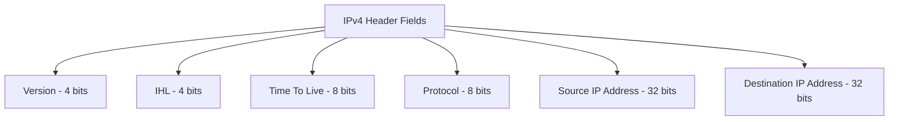
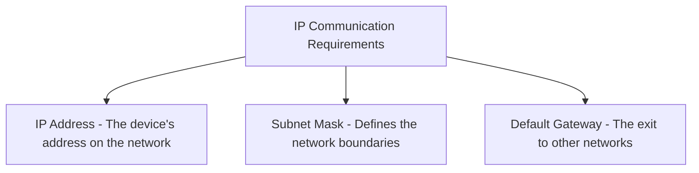
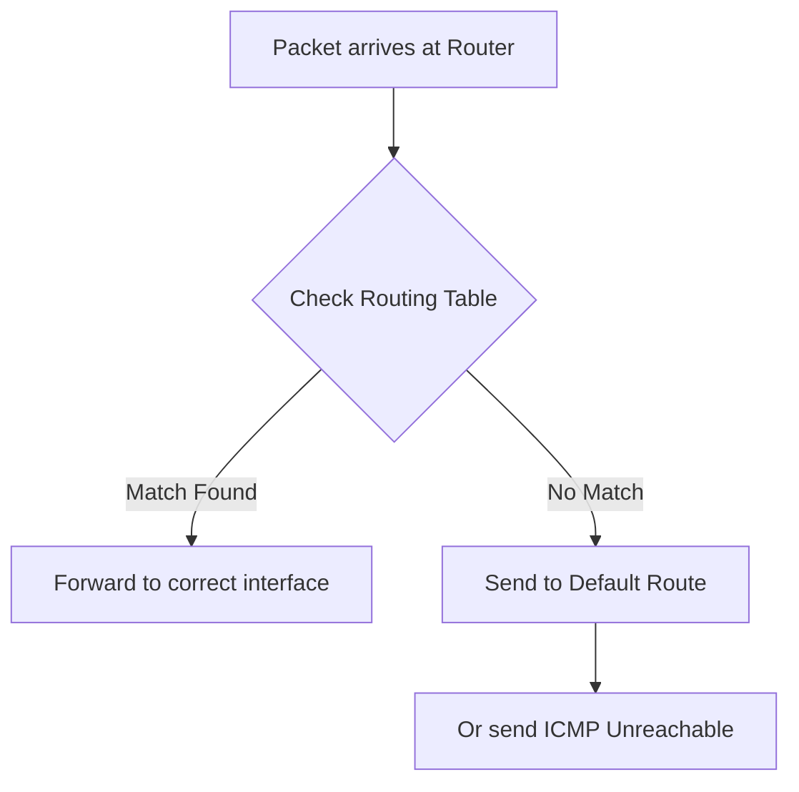
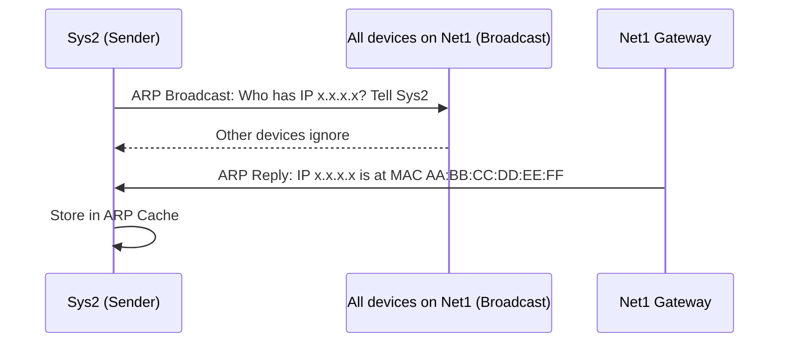
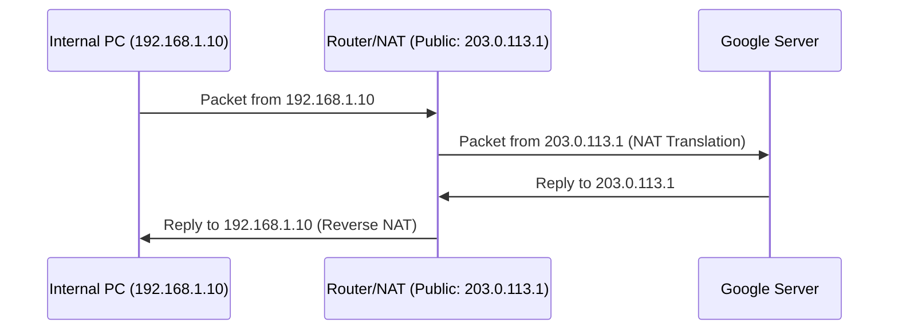

> **Goal of this section:**
> Understand the fundamentals of IP Addressing and Routing, how Packets are routed within the network, and the role of protocols such as ARP and NAT in connecting devices to each other.

---

## Table of Contents

  - [IPv4 Header](#ipv4-header)
  - [IP Protocol Requirements](#ip-protocol-requirements)
  - [Routing and Routing Table](#routing-and-routing-table)
  - [ARP Protocol](#arp-protocol)
  - [Private and Public IPs — NAT](#private-and-public-ips--nat)
  - [Summary](#summary)

---

## IP Addressing and Routing

### IPv4 Header

The **IPv4 Header** is the Header found at the Network Layer (Layer 3). Each row in it represents **32 Bits (4 Bytes)**, and the minimum Header size is **20 Bytes**.



#### The most important Fields in the IPv4 Header:

**Version**
It specifies the version of IP being used.
- The only allowed values: `4` for IPv4 or `6` for IPv6
- Any other value = a **Malformed Packet**, which must be dropped by the Router

**Time-To-Live (TTL)**
The TTL specifies **the maximum number of Hops (Routers)** the Packet can pass through.

- Every time the Packet passes through a Router, the TTL decreases by 1
- If it reaches 0, the Packet is discarded
- The maximum TTL is **255**
- The goal: to stop Packets from wandering around the network forever

> [!TIP]
> The TTL is very useful in Network Forensics — from the TTL value you can roughly tell which operating system a packet came from (Windows starts at 128, Linux starts at 64).

**Protocol**
It specifies **the protocol contained in the Payload**, which the Payload will be handed to at the Transport Layer.

| Protocol Number | Protocol |
|---|---|
| 6 | TCP |
| 17 | UDP |
| 1 | ICMP |

**Source & Destination IP Address**
- **Source Address:** The address of the device that sent the Packet — we say "supposedly," because **IP Spoofing** is possible
- **Destination Address:** The address of the device the Packet is headed to

> [!WARNING]
> When you see the Source IP in a Packet, don't trust it 100%. The Attacker can put any IP Address as the Source. This is the basis of the IP Spoofing attack.

---

### IP Protocol Requirements

For a computer to communicate on the network, it needs 3 essential things:



| Requirement | Purpose |
|---|---|
| **IP Address** | The device's address on the network |
| **Subnet Mask** | Determines which part of the IP represents the network and which part represents the device |
| **Default Gateway** | The Router to which the device sends all Traffic leaving the network |

> [!IMPORTANT]
> The PC itself has a **Routing Table** with at least one Entry, which is the **Default Gateway**. Any Packet headed to another network is sent to the Default Gateway first.

---

### Routing and Routing Table

The **Routing Table** is a table found in every Router (and even in your own PC) that shows how Packets are routed to their destination.

**How Routing works:**
1. The Packet arrives at the Router
2. The Router looks at the Destination IP
3. It searches the Routing Table for the best route
4. It sends the Packet out on the appropriate Interface



---

### ARP Protocol

#### What is ARP?

**ARP (Address Resolution Protocol)** is the protocol that maps the **IP Address to the MAC Address** within the LAN. It is the link between Layer 2 and Layer 3.

**Why do we need it?**
Data is routed using the IP Address, but on the local network it is actually delivered using the **MAC Address**.

#### How does ARP work?



1. The device sends an **ARP Broadcast** on the network: "Who has this IP? Tell me its MAC"
2. All devices see the Broadcast, but those with a different IP ignore it
3. The device that has the IP replies: "Me! And here's my MAC Address"
4. The first device stores this information in the **ARP Cache** in RAM

#### ARP Cache

The **ARP Cache** (or ARP Table) is a temporary table stored in RAM that lets the device remember answers instead of asking over and over.

```bash
# To view the ARP Cache on Windows:
arp -a
```

> [!TIP]
> The ARP Cache is useful in Incident Response — if you see an unusual MAC Address paired with an important IP address (such as the Gateway), there may be an ARP Spoofing/Poisoning attack.

---

### Private and Public IPs — NAT

#### Private vs Public IP Addresses

| Type | Description | Example |
|---|---|---|
| **Public IP** | Travels across the internet; globally unique | 8.8.8.8 |
| **Private IP** | Used only within the local network | 192.168.1.1 |

#### Private IP Address ranges

| Class | Range | Number of Addresses |
|---|---|---|
| Class A | 10.0.0.0 – 10.255.255.255 | 16,777,216 |
| Class B | 172.16.0.0 – 172.31.255.255 | 1,048,576 |
| Class C | 192.168.0.0 – 192.168.255.255 | 65,536 |

> [!IMPORTANT]
> Routers on the internet **do not route** Packets addressed to a Private IP. Private IPs exist only on Internal Networks.

#### NAT — Network Address Translation

**Why do we use NAT?**
IPv4 has about **3.4 billion** IP addresses, but there are more than 4 billion internet users — meaning there's a shortage of IP Addresses. The solution is **NAT**.

**How does NAT work?**



- For Traffic leaving the internal network, the Router changes the Source IP from Private to its own Public IP
- Returning Replies come back to the Router, which knows how to send them back to the correct internal device

#### PAT — Port Address Translation

**PAT** is the most commonly used type of NAT, and it lets many devices inside the network share the same Public IP by using different **Port Numbers**.

> [!NOTE]
> PAT works only for Traffic going out from the internal network to the internet — it doesn't work for Incoming Traffic from the internet.

---
## Summary

- The IPv4 Header contains the TTL, Protocol, and Source/Destination IP
- Every device needs an IP + Subnet Mask + Gateway
- ARP maps an IP to a MAC within the LAN
- NAT solves the shortage of IP Addresses
