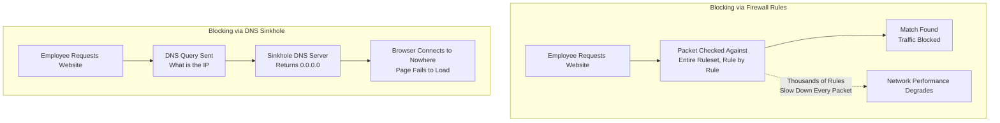

| Topic | Level | Reading Time | Prerequisites |
|---|---|---|---|
| Outbound Traffic Control and DNS Sinkholes | Intermediate | ~18 min | Basic understanding of firewalls, firewall rules, and how DNS resolves domain names |

> **Goal of this section:**
> You'll understand that a firewall doesn't only block attacks coming from outside; it also controls outgoing (outbound) traffic. You'll see why adding thousands of rules to the firewall slows down the network, and how a smarter solution called a **DNS Sinkhole** solves the same problem without affecting performance.

## Learning Objectives

By the end of this section, you will be able to:

- Explain how firewalls control **outgoing (outbound) traffic**, not just incoming traffic.
- Describe the **whitelist approach** (default deny for outbound) and how it differs from blocking specific sites.
- Explain why adding thousands of firewall rules slows down an entire network.
- Define a **DNS Sinkhole** and explain how it blocks access to a website without adding firewall rules.
- Explain how sinkholes are also used to neutralize malware trying to reach its **command-and-control (C2)** server.

## Table of Contents

- [Firewalls Aren't Just About Keeping Attackers Out](#firewalls-arent-just-about-keeping-attackers-out)
- [Blocking Specific Websites](#blocking-specific-websites)
- [Going Further: The Whitelist Approach](#going-further-the-whitelist-approach)
- [The Catch: Every Rule Slows the Firewall Down](#the-catch-every-rule-slows-the-firewall-down)
- [The Real-World Problem This Creates](#the-real-world-problem-this-creates)
- [The Sinkhole: A Smarter Solution](#the-sinkhole-a-smarter-solution)
- [How a Sinkhole Actually Works](#how-a-sinkhole-actually-works)
- [Why This Is Smarter Than Firewall Rules](#why-this-is-smarter-than-firewall-rules)
- [Sinkholes Against Malware](#sinkholes-against-malware)
- [Firewall Rules vs. Sinkhole Diagram](#firewall-rules-vs-sinkhole-diagram)
- [Career Connection](#career-connection)
- [Key Terms Glossary](#key-terms-glossary)
- [Summary](#summary)

## Firewalls Aren't Just About Keeping Attackers Out

So far, we've talked about the firewall blocking **incoming traffic**, meaning it protects you from the outside world.

But the firewall can also control **outgoing traffic**, meaning exactly what your employees are allowed to reach.

## Blocking Specific Websites

A company can use the firewall to prevent employees from visiting certain websites, such as social media, **gambling sites**, or **known malicious domains**, and so on.

## Going Further: The Whitelist Approach

An organization can go even further: **block the internet completely by default** and allow only the work-related websites that employees actually need.

This approach is called **"default deny"** or the **whitelist approach**.

> [!NOTE]
> This is the same **Default Deny** idea we studied earlier for incoming traffic, but here it's applied to outgoing traffic: instead of specifying what's blocked, you specify only what's allowed.

## The Catch: Every Rule Slows the Firewall Down

The **catch** here: every single rule you add to the firewall makes it **slower**.

Every packet that passes through has to be **checked against the entire ruleset**, one rule at a time, until it finds a match.

> [!WARNING]
> Imagine **airport security** having to check every passenger's bag against a list of 10,000 rules, one by one, even if you only need to check 3 things. The process gets slower and slower as the rulebook grows.

## The Real-World Problem This Creates

If you try to block thousands of websites using firewall rules alone, your entire network will become slower for everyone.

> [!IMPORTANT]
> This is the real problem that leads us to a smarter solution: **the Sinkhole**.

## The Sinkhole: A Smarter Solution

Instead of piling thousands of "block this site" rules onto your main firewall, you can solve the same problem using the company's **DNS server** instead.

Remember: before your machine can visit any website, it first asks a DNS server, "What is this website's IP address?" That is exactly how web browsing always begins.

## How a Sinkhole Actually Works

A **Sinkhole** works by configuring the company's DNS server to **deliberately lie**: for any blocked website, instead of returning the real IP address, it returns `0.0.0.0` (a dead-end address that leads nowhere).

So when an employee types a blocked website, their machine asks, "What is this site's IP?", the DNS server replies `0.0.0.0`, and the browser tries to connect to nothing; the page simply fails to load.

> [!NOTE]
> It's like a telephone operator who, when you ask for a scammer's phone number, simply tells you "this number doesn't exist," so you never actually reach that number.

## Why This Is Smarter Than Firewall Rules

Why is this solution smarter than firewall rules? **DNS** queries are a single, fast step that already happens for every website visit anyway. You're not adding extra inspection work for every packet; you're just changing **one answer** at the start of the process.

> [!IMPORTANT]
> The fundamental difference is that firewall rules add an inspection burden to **every packet** passing through the firewall, while the sinkhole only changes **a single DNS answer** in a step that already exists and is fast. The end result is the same (the site doesn't open), but the cost to network performance is completely different.

## Sinkholes Against Malware

Sinkholes are also widely used by security teams to stop **malware**: if a virus tries to **phone home** to its **command-and-control (C2)** server, the sinkhole's DNS record sends that traffic to a place that doesn't exist, which **neutralizes** the connection completely.

> [!TIP]
> Using a sinkhole against malware is an excellent example of how a tool originally designed for one purpose (preventing employees from accessing certain sites) can be adopted and used as a much broader defensive tool in cybersecurity.

## Firewall Rules vs. Sinkhole Diagram

The following diagram compares the blocking path using traditional firewall rules with the blocking path using a DNS sinkhole:

## Career Connection

Understanding outbound traffic control and DNS sinkholes has direct applications across several career paths:

- In **SOC**, monitoring DNS sinkhole logs helps detect malware-infected machines trying to communicate with C2 servers.
- In **Network Security Engineering**, designing a balanced strategy between firewall rules and DNS sinkholes is a core part of maintaining network performance while enforcing strict security policies.
- In **Threat Intelligence**, updating the sinkhole's blocked domain lists based on new threat intelligence is a core part of the daily work.
- In **GRC**, applying a **whitelist** policy to outbound traffic is part of the compliance requirements in highly sensitive environments.

## Key Terms Glossary

| Term | Definition |
|---|---|
| **Outbound Traffic** | Traffic leaving the internal network for the internet or other networks. |
| **Whitelist Approach** | A policy that blocks all traffic by default and allows only what has been explicitly specified as allowed. |
| **DNS Sinkhole** | A technique that modifies DNS responses to direct blocked websites to an address that doesn't exist. |
| **0.0.0.0** | An IP address used as a "dead end" that doesn't point to any real device. |
| **Command-and-Control (C2)** | A server attackers use to remotely control malware-infected machines. |
| **Phone Home** | A term for a malicious program's attempt to communicate with its control server. |

## Summary

- The firewall doesn't only block attacks coming from outside; it can also control **outbound** traffic, meaning what your employees are allowed to reach.
- Organizations can block specific websites, or go with the **whitelist** approach: block the entire internet by default and allow only work-related websites.
- Every additional firewall rule slows down the inspection of every packet, which means that trying to block thousands of websites using firewall rules alone slows down the whole network.
- A **DNS Sinkhole** is a smarter solution: it configures the DNS server to return `0.0.0.0` (an address that leads nowhere) instead of the real IP address for any blocked website.
- A sinkhole is smarter than firewall rules because the DNS query is a fast step that already exists for every website visit; you just change one answer instead of adding an inspection burden to every packet.
- Sinkholes are also widely used to neutralize **malware** trying to communicate with its **command-and-control (C2)** server.

